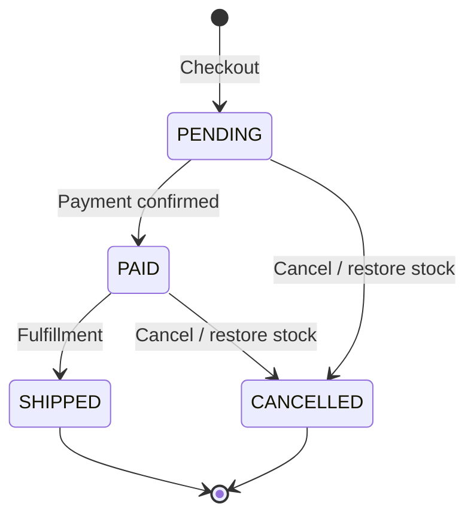

# Business analysis and workflows

## Scope and assumptions

The system supports customer accounts, product categories/catalog, a browser-based shopping cart, checkout, and an administration page. The cart is kept in browser local storage until checkout; creating an order persists the order and its lines in MySQL. The classroom demo returns a non-authorizing demo token after authentication. It is not production authentication, and the admin page is intentionally not protected.

## User stories

### Customers
- As a shopper, I can register with a name, valid email, password, and phone number so my orders are associated with my account.
- As a returning shopper, I can sign in with my email and password and continue checkout.
- As a shopper, I can view and update my profile and see my order history.
- As a shopper, I receive a validation or conflict message when registration data is invalid or the email is already in use.

### Categories and products
- As a shopper, I can browse a paginated catalog, inspect product name, description, image, price, category, and stock.
- As a shopper, I can search by name/description and filter by category and price range.
- As an administrator, I can add products/categories and update product stock.
- As an administrator, I can review available inventory in the admin page.

### Cart and orders
- As a shopper, I can add items, change quantities, and remove items in my cart before checkout.
- As a shopper, I can submit an order for my cart and see a generated order number and total.
- As a shopper, I cannot check out when the requested quantity exceeds stock; no partial stock change is committed.
- As an administrator, I can view orders and move them from PENDING to PAID and then SHIPPED.
- As a shopper/administrator, I can cancel a PENDING or PAID order; cancellation restores all reserved quantities exactly once.

## Business rules

1. Registration email is unique (case-insensitive), and passwords are stored as BCrypt hashes.
2. Product prices and stock are non-negative; checkout requires a positive quantity and sufficient stock for each product.
3. Checkout is one transaction: order, order items, total, and stock deductions commit together or roll back together.
4. Permitted order transitions are PENDING -> PAID -> SHIPPED, with cancellation allowed from PENDING or PAID. SHIPPED and CANCELLED are terminal states.
5. Cancellation restores inventory in the same transaction and cannot be repeated or applied after shipment.
6. Cart contents are browser-local and may be lost if browser storage is cleared; checkout re-validates stock on the server.

## Checkout workflow

```mermaid
sequenceDiagram
  actor Shopper
  participant UI as Storefront
  participant API as Spring Boot API
  participant DB as MySQL
  Shopper->>UI: Select products and quantities
  UI->>UI: Update local cart and total
  Shopper->>UI: Checkout
  UI->>API: POST /api/v1/orders
  API->>DB: Begin transaction; lock/check product stock
  API->>DB: Insert order + lines; decrement stock
  DB-->>API: Commit transaction
  API-->>UI: 201 Created + order number + total
  UI-->>Shopper: Show order confirmation
```

## Cancellation and status workflow


